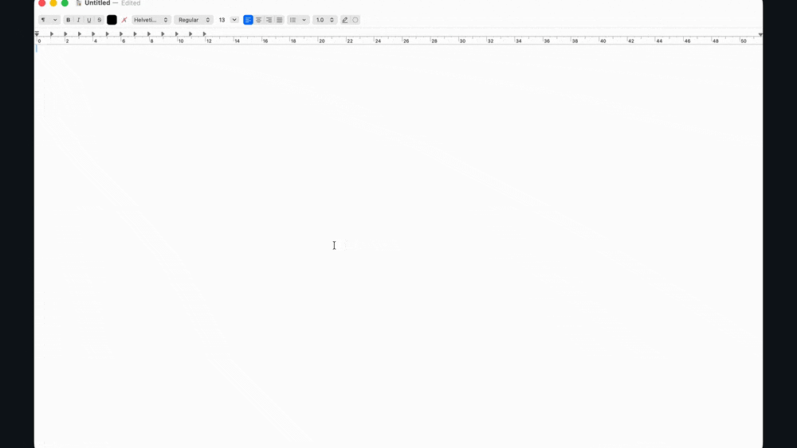
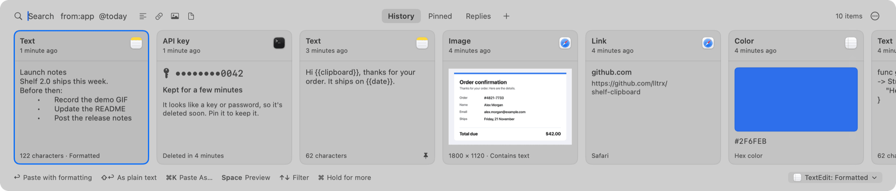
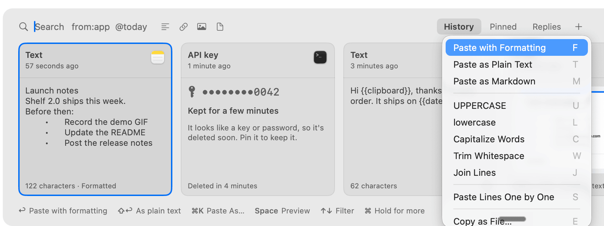
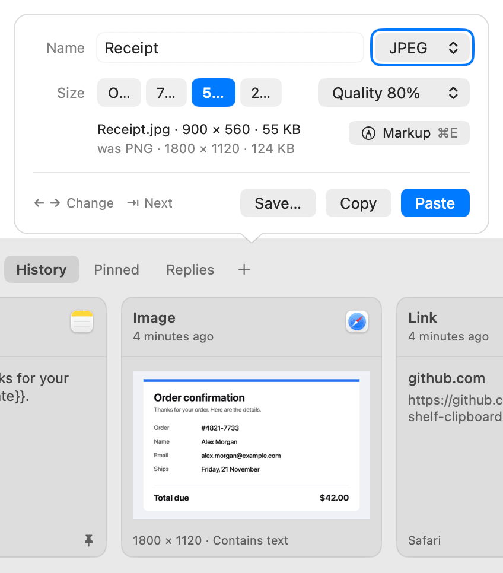
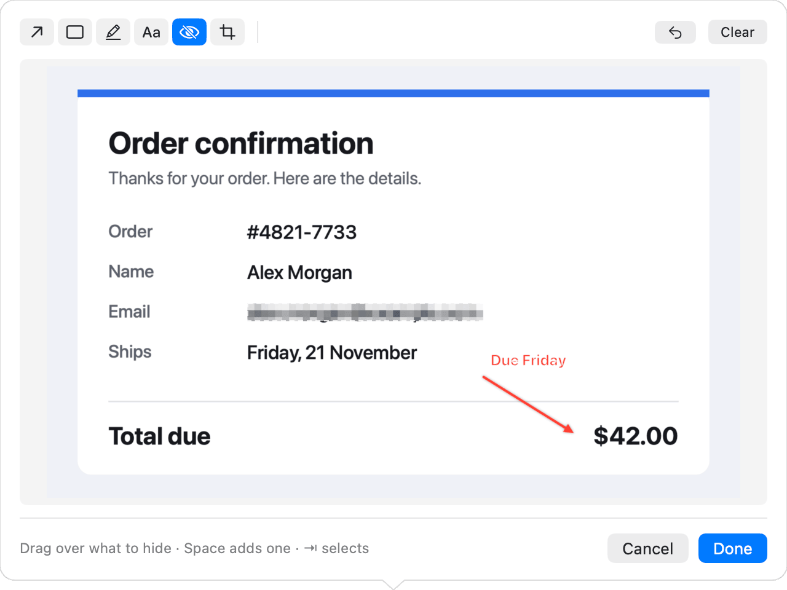
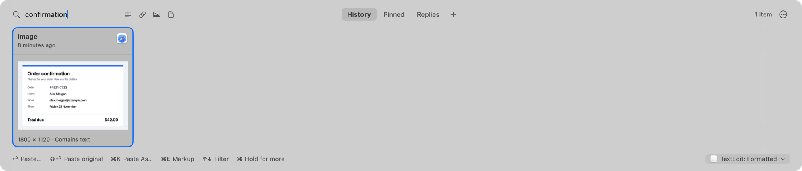
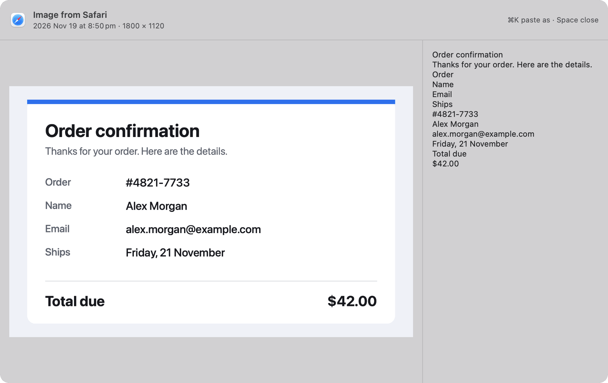
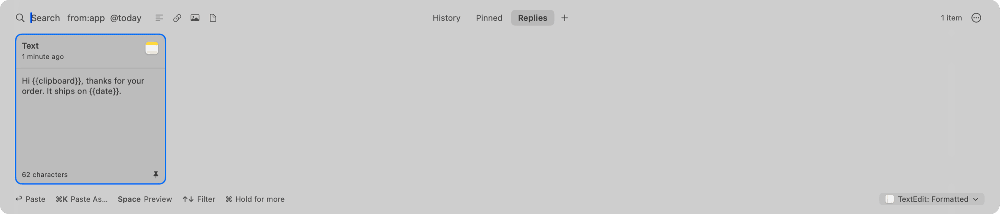
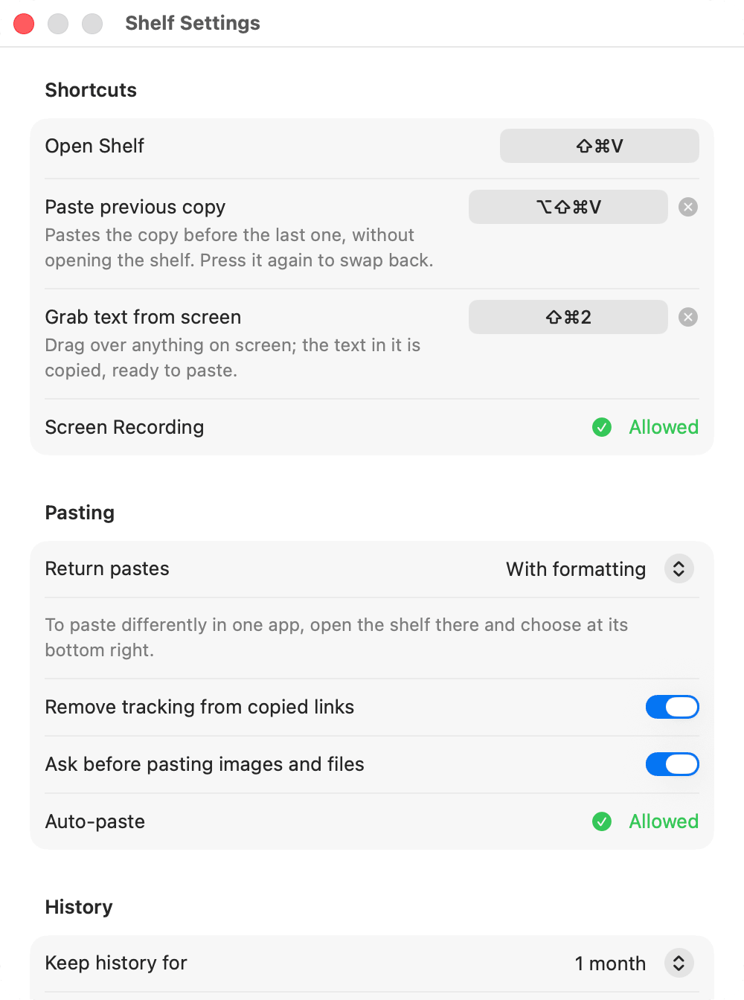

# Shelf — local clipboard history

A small native macOS clipboard manager (Swift/SwiftUI, no dependencies). Everything you copy stays on
your Mac: no iCloud, no account, no network code. Free and open source (MIT).

Press **⇧⌘V** anywhere for a row of everything you copied, and Return to paste it. Also:

- Paste the way the app needs it: plain or formatted per app, or as Markdown, UPPERCASE, clean JSON, a
  link without tracking (**⌘K**).
- Rename, resize or convert images and files before pasting them, and mark up screenshots with
  arrows, text, blur and crop (**⌘E**).
- Grab the text from anything on screen (**⇧⌘2**), search inside screenshots, and find copies by app
  or date (`from:slack @today`).
- Pinboards for things you paste often, with snippets like `{{date}}`.
- Keys, tokens and passwords are masked and deleted after a few minutes; password managers are skipped.



▶ [Watch the 30-second video](https://github.com/lltrx/shelf-clipboard/releases/download/v2.0.1/shelf-2.0-demo.mp4)



| Paste As (⌘K) | The paste box (Return on an image) | Markup (⌘E) |
|---|---|---|
|  |  |  |

| Search, even inside images | Full preview (Space) | Pinboards and snippets |
|---|---|---|
|  |  |  |



- [User guide](docs/USER_GUIDE.md): every feature and shortcut
- [Install guide](docs/INSTALL.md): for other people, including updating and uninstalling
- [Maintainer handover](docs/HANDOVER.md): architecture, data, build, signing, releasing

## Install

Requires macOS 14 Sonoma or later (Apple Silicon or Intel).

**With Homebrew** (current Homebrew asks you to trust a tap before installing from it):

```sh
brew trust lltrx/tap
brew install --cask lltrx/tap/shelf-clipboard
```

**Or download a release:** grab the latest `Shelf-<version>.zip` from the
[Releases page](https://github.com/lltrx/shelf-clipboard/releases), unzip it and move **Shelf.app** to
Applications. Shelf is signed with an Apple Developer ID and notarized by Apple, so it opens like any
other downloaded app.

**Then:** press ⇧⌘V, pick a card and press Return. macOS asks to allow Shelf in **Accessibility**, which
it needs to paste for you; switch it on. The [Install guide](docs/INSTALL.md) has the details, plus
updating and uninstalling.

**Or build from source:**

```sh
./build.sh --install   # builds, signs, installs to ~/Applications/Shelf.app and launches
```

## Maintainer / development

```sh
./build.sh --install          # build + install locally
./build.sh --package          # zip for sharing: dist/Shelf-<version>.zip (+ INSTALL/USER_GUIDE)
scripts/release.sh            # package and publish a GitHub release (maintainer only)
swift scripts/make_icon.swift # only if you change the icon
```

build.sh signs with the maintainer's Developer ID when it's in the keychain (releases are also
notarized), otherwise with a local **Shelf Local Signing** identity, otherwise ad-hoc. See
[docs/HANDOVER.md](docs/HANDOVER.md#code-signing).
Contributions are welcome — see [CONTRIBUTING.md](CONTRIBUTING.md).

## Keys (while the shelf is open)

| Key | Action |
|---|---|
| ⇧⌘V | Open / close the shelf (anywhere; change it in Settings) |
| ⌥⇧⌘V | Anywhere: paste the copy before the last one without opening the shelf (again to swap back) |
| ⇧⌘2 | Anywhere: **grab text from screen**: drag over anything; the text in it is recognized on the Mac and copied |
| type | Search: text, links, file names, source app, and text inside screenshots. `from:slack`, `@today`, `@yesterday`, `@week`, `@month` narrow it down |
| ← → (⌘← ⌘→) | Move selection (jump to ends) |
| ↑ ↓ | Show only text, links, images or files (or click the icons next to search) |
| Return / double-click | Paste: with formatting, or as plain text in apps you set that way. On an image or file, a small box opens first to rename, resize or convert it; Return again pastes |
| ⇧Return | Paste the other way (plain text ↔ with formatting); on an image or file, paste it as it is, skipping the box |
| ⌘K | **Paste As:** formatted, plain text, Markdown, UPPERCASE / lowercase / Capitalized, trimmed, joined lines, formatted JSON, link without tracking, text in an image, file paths or names, and **lines one by one** (each ⌘V pastes the next line) |
| ⌘R | **Copy as File:** the same box for any card: name it and pick a format (PNG, JPEG, HEIC, TIFF, GIF, PDF · Plain Text, Markdown, RTF, Word, HTML), then paste (Return), copy (⌘C) or save (⌘S) it |
| ⌘E on an image | **Markup:** arrows (A), boxes (R), highlights (H), text (T), blur (B, a mosaic) and crop (C), colors 1–7. All by keyboard too: Space adds, Tab selects, arrows move, ⌥ arrows resize, ⌫ deletes, Return is Done |
| ⌘1 … ⌘9 (⇧ for the other way) | Paste item 1–9 (hold ⌘ to see the numbers and every ⌘ shortcut) |
| drag a card | Drop it into another app (images become a named PNG file). Dragging a marked card drags all the marked ones; a card with several files drags them all |
| Space | Full preview (when the search field is empty); files open in Quick Look |
| ⌘E on text | Edit in the preview, then ⌘Return to paste (⇧⌘Return plain) · Esc cancels |
| ⌘C | Copy to clipboard without pasting |
| ⌘P | Pin / unpin (asks which pinboard when there are several; 1–9 picks) |
| ⌘N | New pinboard |
| Tab / ⇧Tab | Next / previous tab (History, then each pinboard) |
| ⌘S, ⇧-click, ⇧← ⇧→ | Mark cards (⌘S also moves to the next card) |
| Return (with marked cards) | Paste stack: pastes item 1, then each ⌘V you press pastes the next |
| ⌥Return (with marked cards) | Paste them all at once, one per line |
| ⌘J | Join the marked cards into one new card |
| ⌘⌫ | Delete the card, or the marked cards |
| ⌘Z | Undo delete (the last 20 deletes) |
| ⌘, | **Settings:** shortcuts, paste style, history length, when keys and passwords are deleted, screenshots, ignored apps, launch at login |
| ⋯ (top right) | Shelf menu: Pause Capture, Settings, export and import pinboards, Forget Last 5 Minutes, Clear Unpinned History |
| Esc | Close preview, then the shelf |

The bar at the bottom of the shelf shows what the keys do for the selected card. At its right,
**Excel: Plain Text** (for example) says what Return pastes in the app you're pasting into; click it to
choose formatted or plain text for that app. Shelf remembers it per app.

Right-click a card for the same actions; right-click a pinboard tab to rename or delete it
(deleting a pinboard moves its items back to History). A running paste stack shows `n/total` in the
menu bar, with Skip and End there; copying something new ends it.

Pinned text can hold **snippet placeholders**, filled in when it's pasted: `{{date}}`, `{{time}}`,
`{{datetime}}`, `{{isodate}}`, `{{clipboard}}` and `{{uuid}}`.

## Data

- `~/Library/Application Support/Shelf/history.sqlite` (mode 600) and `images/` (PNG files), folder mode 700.
- Keep this folder out of git repositories and synced folders: it can contain passwords and other secrets.
- Unpinned items are deleted after 30 days (Settings: 1 week to forever); pinned items never expire.
- Text keeps RTF / HTML / RTFD formatting (up to 10 MB each). Edited text is saved as a new item;
  text changed by Paste As (⌘K) is pasted but not saved.
- Files made by Copy as File (⌘R) and images dragged out of the shelf are written to `Exports/`
  and deleted after a day (the app you paste or drop them into keeps its own copy).
- Screenshots you take (saved as files) are added to History too; turn that off in Settings.
- Screenshot text is recognized on-device with Apple Vision (English and Arabic) in the background.
- Passwords copied from password managers are not recorded; ⌘V still pastes them, and a 🔒 card
  in the shelf shows one is on the clipboard.
  Apps you add to **Ignored apps** (Settings, or right-click a card) are never recorded.
- Keys, tokens and passwords copied from ordinary text (API keys, private keys, JWTs, `password=…`,
  links with a password, card numbers) are shown masked and deleted after 5 minutes unless pinned
  (Settings: 1 minute to never). **Forget Last 5 Minutes**, **Pause Capture** and **Clear Unpinned
  History…** are in the Shelf menu.
- Tracking parameters (utm_…, fbclid, gclid…) are removed from links as they're copied, on the card
  and the clipboard (Settings to turn off).
- Grab Text from Screen uses the system screenshot tool and Apple Vision on the Mac; it needs Screen
  Recording permission. The captured image is deleted right after the text is read.

## Backups

- Pinboards are backed up automatically once a day to `~/Library/Application Support/Shelf/Backups/`
  (`pinboards-YYYY-MM-DD.json`, last 7 kept, mode 600). History itself is not backed up; it expires anyway.
- **Export Pinboards…** (menu bar) writes the same single JSON file anywhere you choose; images and
  formatting are embedded. It may contain secrets, so keep it somewhere private, not in a shared or synced folder.
- **Import Pinboards…** merges a file back in: pinboards are matched by name, nothing is overwritten.
